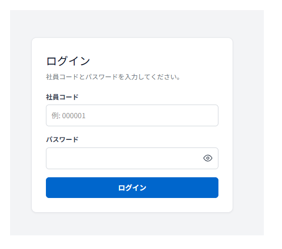
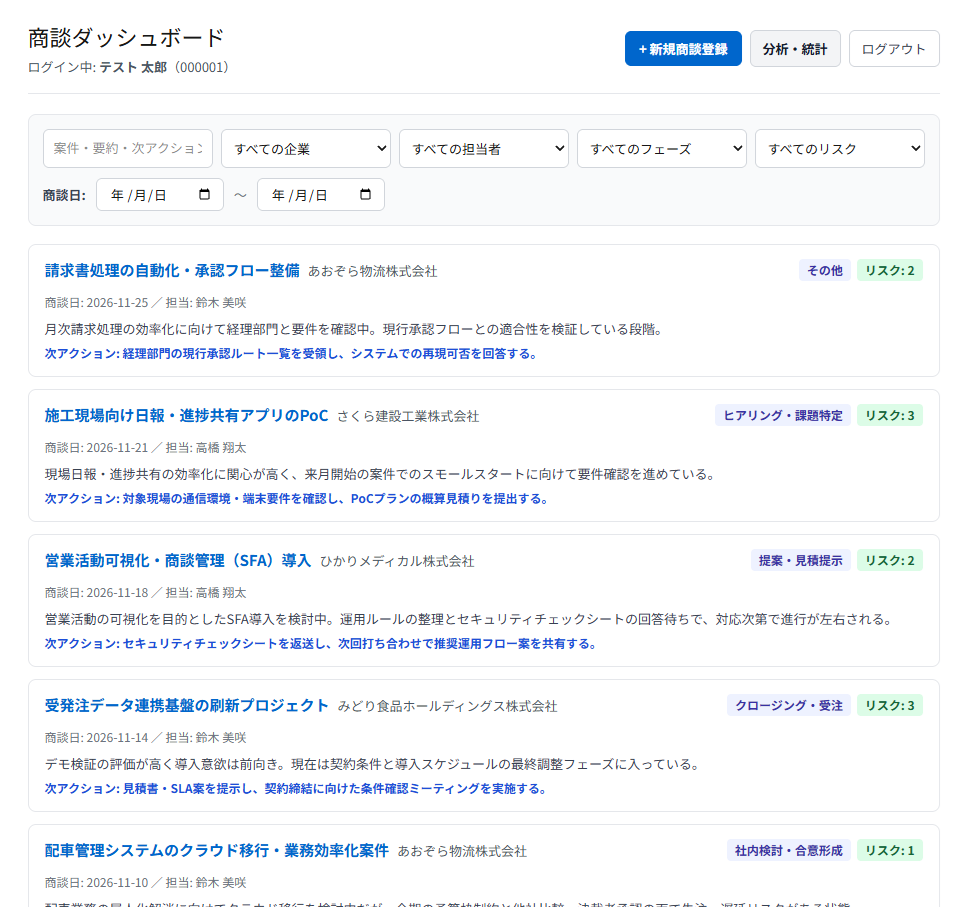
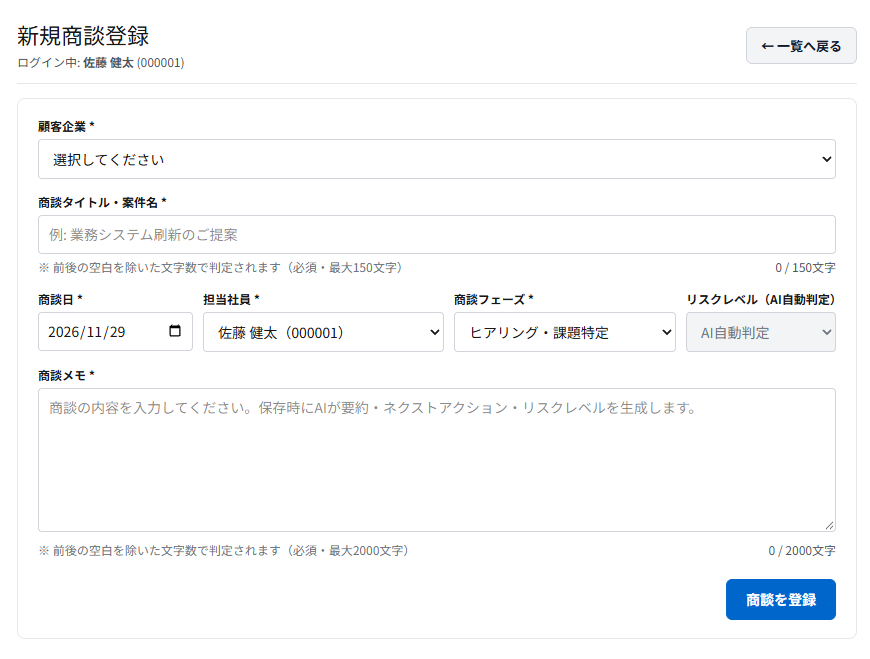
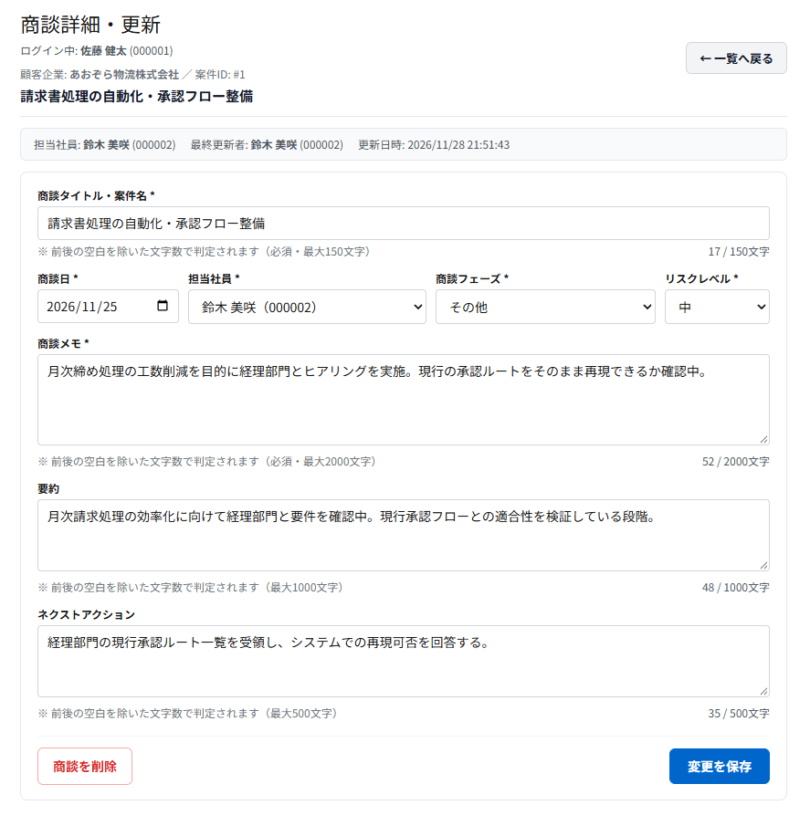
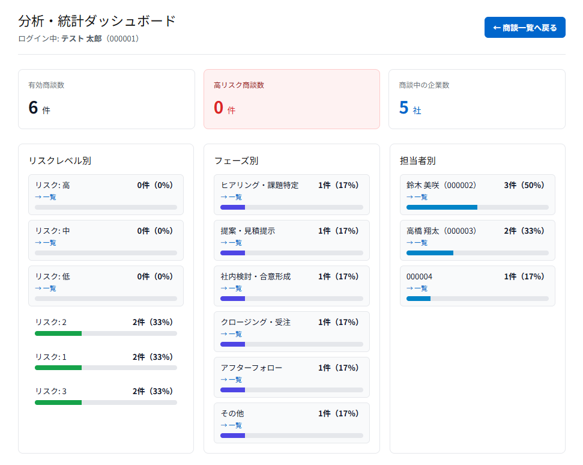
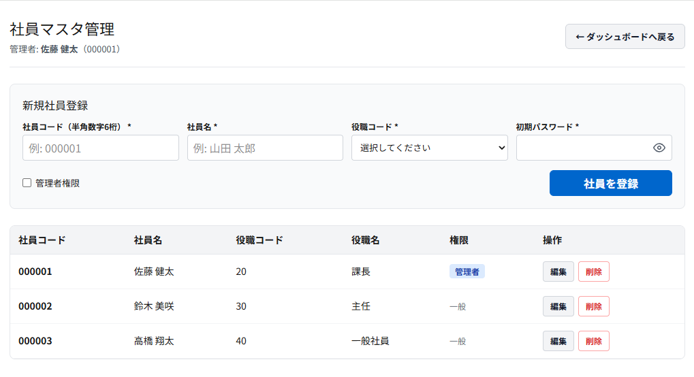
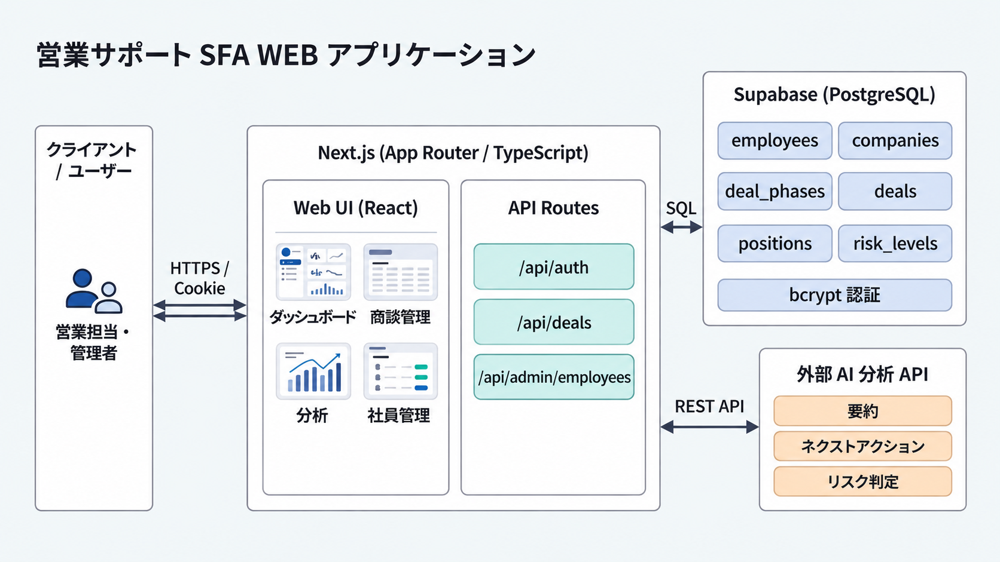
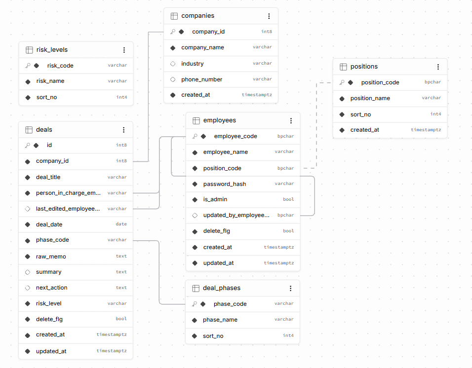

# 商談分析・営業支援ダッシュボード（Deal Analytics Dashboard）

商談メモの記録・AI分析（要約・ネクストアクション抽出・リスク評価）、商談の進捗・リスク管理、集計分析、社員管理を行う営業支援（SFA）Webアプリケーションです。

- 本番URL: https://deal-analytics-dashboard.vercel.app
- 画面イメージ：

### ログイン画面


### 商談ダッシュボード・一覧画面


### 商談新規登録画面


### 商談詳細・AI分析画面


### 分析・集計画面


### 社員マスタ管理画面


## 開発背景・目的
- 課題：商談メモがテキストのまま散在しやすく、案件ごとの進捗状況や失注・遅延リスク、次のアクションが一目で把握しづらい不便さがあった
- 解決策：商談メモから要約・ネクストアクション・リスクレベルを整理して管理し、フェーズやリスク、担当者別に一覧・分析できる仕組みを作り、営業活動の可視化とフォロー漏れ防止を改善した

## 主な機能
- **認証・権限制御**
  - 社員コードとパスワードによるログイン・ログアウト（`bcrypt` ハッシュ検証、セッション Cookie 管理）
  - 管理者権限（`is_admin`）による管理機能アクセス制御および論理削除（`delete_flg`）による退職済み社員対応
- **商談管理（CRUD・検索・フィルタリング）**
  - 商談の新規登録・一覧表示・詳細確認・編集・削除
  - 顧客企業、担当社員、商談フェーズ（`deal_phases`）、リスクレベルでの絞り込み・確認
- **AI分析支援・集計分析**
  - 商談メモ（`raw_memo`）をもとにした要約（`summary`）、ネクストアクション（`next_action`）、リスク評価（`risk_level`）の整理・登録補助
  - ダッシュボードおよび分析画面での案件状況・リスク分布の可視化
- **社員マスタ管理**
  - 社員情報の登録・編集・論理削除などの管理機能

## 使用技術
- フロントエンド：TypeScript / Next.js（App Router）/ React
- バックエンド：Next.js Route Handlers（`/api/...`）
- データベース：Supabase（PostgreSQL）
- 認証・セキュリティ：`bcrypt` / HTTP Cookie セッション管理
- 品質チェック・ビルド：ESLint / TypeScript（`tsc --noEmit`）/ Next.js Build

## システム構成図

- 工夫した点：マスタテーブル（`deal_phases`、`positions`、`risk_levels`）と論理削除（`delete_flg`）を組み込み、運用時のデータ整合性や退職済み担当者の履歴参照しやすさに配慮した構成にした

## ER図

- **テーブル構成（全6テーブル）**：
  - `deals`：商談情報および AI 分析結果（要約・ネクストアクション・リスク評価・メモ・論理削除フラグなど）を管理
  - `companies`：商談先の顧客企業情報を管理
  - `employees`：社員情報、権限（`is_admin`）、論理削除フラグ（`delete_flg`）などを管理
  - `deal_phases`：商談フェーズのマスタデータ
  - `positions`：社員の役職マスタデータ
  - `risk_levels`：商談リスクレベルのマスタデータ
- **設計のポイント**：
  - `deals` を中心に `companies`、`employees`、`deal_phases`、`risk_levels` を関連付け、案件の進捗・担当・リスクを一元管理できるように設計
  - `employees` と `positions` をマスタ分離し、論理削除（`delete_flg`）と組み合わせることで、退職者の過去商談履歴や参照整合性を保ちやすくした

## 技術選定の理由と課題解決
- **技術選定**：TypeScript と Next.js（App Router）、Supabase（PostgreSQL）を採用し、画面から API ルート・DB スキーマまで型と制約を揃えて保守性と開発スピードを重視した
- **直面した課題と対応**：
  - **AI分析の安定化**：商談メモのAI分析結果がそのままDB制約に抵触しないよう、要約・ネクストアクション・リスクレベル（マスタコード値）への整形・検証処理をAPI側に実装し、APIエラー時も手動入力で業務を継続できるよう対応した
  - **論理削除と履歴整合性の両立**：社員・商談データに論理削除（`delete_flg`）を採用し、通常の一覧・選択肢からは除外しつつ、過去商談の担当者・更新者履歴は参照できるようクエリ条件と権限チェックを整理した

## 起動・確認手順

### 公開環境（デモURL）での確認
デプロイ済みの環境では環境変数およびデータベースが設定済みのため、以下のURLとデモアカウントからすぐにご確認いただけます。

- **URL:**[ （※公開URLを記載）](https://deal-analytics-dashboard.vercel.app)
- **デモ用ログイン情報:**
  - **管理者アカウント:** 社員コード `000001`（佐藤 健太） / パスワード `（DemoPass123!）`
    ※ 社員マスタ管理画面（`/admin/employees`）の操作も確認可能です。
  - **一般社員アカウント:** 社員コード `000002`（鈴木 美咲） / パスワード `（DemoPass123!）`
  - **その他の登録済み社員コード:** `000003`（高橋 翔太）、`000005`（渡辺 翼）
    ※ `000004`（伊藤 陽子）は退職済み（論理削除済み）データとして登録されています。
---

### ローカル環境でのビルド・起動手順

- 本リポジトリは環境変数未設定の状態でもビルド（`npm install` / `npm run build`）が通る設計としています。
- ローカルでDB・AI連携を含めて起動する場合は、`.env.example` をコピーして `.env.local` を作成し、ご自身の Supabase / Gemini API キー等を設定のうえ `npm run start` を実行してください。

#### 1. リポジトリのクローン・移動
```bash
git clone https://github.com/dqice22/deal-analytics-dashboard.git
cd sales-ai-tool